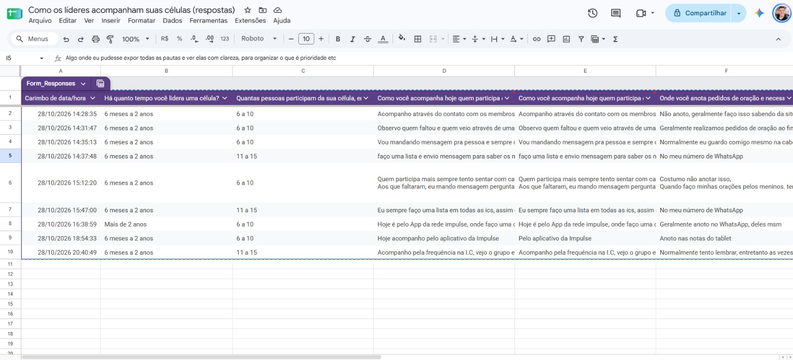
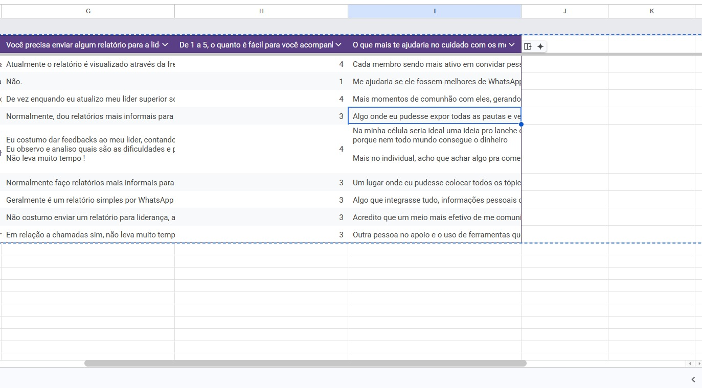

# Da Hipótese à Evidência: validando um assistente com IA para líderes de célula

> Case de Product Discovery da disciplina **Metodologias Ágeis e Validação de Produtos** (UniFecaf / Rocketseat).
> Autor: Danilo Gonçalves Frazão Matos · Outubro de 2026

## Resumo

| | |
|---|---|
| **Hipótese inicial** | Líderes de célula têm dificuldade em acompanhar presença e necessidades dos membros e em montar o relatório para a liderança. Uma IA que organiza tudo isso a partir de um áudio semanal teria valor. |
| **Experimento** | Formulário de problema com 8 líderes de célula reais (Google Forms, 28/10/2026). |
| **Resultado** | Hipótese **parcialmente refutada**. Presença já é controlada (6 de 8 usam lista ou app) e o relatório não pesa (0 de 8). Mas **nenhum líder tem um lugar organizado** para pedidos de oração e necessidades de cada membro, e 4 de 8 pediram isso espontaneamente. |
| **Decisão** | **Ajustar**: manter o público e estreitar o problema para a **memória do cuidado com cada membro**. |
| **Descoberta secundária** | Engajamento dos membros e ideias para os encontros (5 de 8), registrado para um próximo ciclo. |

---

## 1. Problema e público

**Contexto:** células são grupos pequenos de uma igreja que se reúnem nas casas, com um líder responsável por acompanhar os membros.

**Problema hipotético:** o líder não tem um jeito organizado de acompanhar quem faltou, quem está se afastando e quem pediu oração. As informações ficam espalhadas entre WhatsApp, caderno e memória, e o relatório para a liderança toma tempo.

**Público:** líderes de célula (principal) e supervisores/pastores (secundário).

## 2. Hipóteses

| Tipo | Hipótese | Critério de sucesso |
|---|---|---|
| Problema | Líderes não têm um jeito organizado de acompanhar os membros e percebem tarde quando alguém se afasta. | 80% ou mais relatam dificuldade **e** nota média de facilidade ≤ 3 |
| Solução | Um resumo semanal gerado por IA a partir de um áudio do líder organiza esse acompanhamento. | 80% ou mais consideram o resumo útil |
| Valor | Líderes querem receber o resumo toda semana. | 60% ou mais querem receber ou usam o relatório com a liderança |

Os critérios foram definidos para 5 líderes (4 de 5, 4 de 5 e 3 de 5) e aplicados em proporção às 8 respostas válidas.

**Regra de decisão (definida antes do experimento):**

| Resultado | Decisão |
|---|---|
| Todos os critérios atingidos | Perseverar |
| Problema confirmado em parte, solução precisa ser refocada | **Ajustar** |
| Os líderes revelam uma dor diferente | Pivotar |
| 1 ou menos líderes relatam a dificuldade | Abandonar |

## 3. Canvas de produto (Lean Canvas)

A coluna da direita mostra o que mudou depois das evidências.

| Bloco | Hipótese inicial | Após o experimento |
|---|---|---|
| **Problema** | Acompanhar presença e necessidades dos membros; relatório trabalhoso | Ajustado. Presença e relatório não doem; a dor é **guardar e lembrar as informações de cuidado de cada membro** |
| **Segmento de clientes** | Líderes de célula; supervisores | Mantido (líderes) |
| **Proposta de valor** | "Mande um áudio depois da célula e receba o acompanhamento da semana organizado" | Revisada: "Nunca mais esqueça um pedido de oração, um aniversário ou um membro sem discipulado" |
| **Solução** | Assistente com IA no WhatsApp: presença, faltas, pedidos de oração, alertas e relatório | Ficha de cuidado por membro, alimentada por áudio do líder, com lembretes semanais gerados por IA |
| **Canais** | WhatsApp; rede de supervisores da igreja | Mantido |
| **Fluxo de receita** | Igreja assina por rede de células (não testado) | Não testado |
| **Estrutura de custos** | API de IA, API do WhatsApp, desenvolvimento | Não testado |
| **Métricas-chave** | % de líderes que enviam o relato semanal | % de líderes que agem a partir dos lembretes |
| **Vantagem injusta** | Acesso direto a líderes de células | Mantido |
| **Concorrência** | Planilhas, WhatsApp, aplicativos de igreja | Atenção: 3 de 8 já usam o aplicativo da igreja para frequência; a solução deve complementar o app, não competir com ele |

## 4. Experimento

**Tipo:** formulário de problema (Google Forms), com 8 perguntas sobre comportamento atual, sem mencionar a solução.

**Participantes:** 9 respostas de líderes de célula reais, contatados individualmente pelo WhatsApp em 28/10/2026, entre 14h28 e 20h40.

**Resposta descartada:** a resposta das 15h47 era da mesma pessoa que respondeu às 14h37. Foi mantida apenas a primeira, ficando **8 respostas válidas**.

**Perfil:** 7 lideram há 6 meses a 2 anos e 1 há mais de 2 anos; 5 têm células de 6 a 10 pessoas e 3 de 11 a 15.

**Fase 2 (concierge MVP):** planejada, mas **não executada**. Os resultados da fase 1 mostraram que a solução original (presença + relatório) mirava a parte errada do problema. O concierge passa a ser o próximo experimento, já com o problema ajustado.

## 5. Evidências

Respostas anonimizadas (Líder 1 a 8, na ordem de chegada). A planilha original e os prints estão em [`/evidencias`](./evidencias).

| Líder | Como acompanha a presença | Pedidos de oração | Relatório para a liderança | Facilidade (1–5) | O que mais ajudaria |
|---|---|---|---|---|---|
| 1 | Contato + aplicativo da igreja | Não anota; de memória | Automático pelo app | 4 | Membros mais ativos: convidar, sugerir lanche e programações |
| 2 | Lista + mensagem para quem faltou | Conversa do WhatsApp | Não envia | 1 | Membros que respondam melhor no WhatsApp |
| 3 | Mensagens individuais | De cabeça | Informal, sem frequência fixa | 4 | Mais momentos de comunhão e confiança |
| 4 | Lista + mensagem | WhatsApp | Informal, por WhatsApp | 3 | Ver as pautas com clareza e priorizar |
| 5 | Conversa individual + mensagem | Lista de nomes; de memória | Informal; "não leva muito tempo" | 4 | Ideias de lanche e carona; como puxar conversa |
| 6 | Aplicativo da igreja | WhatsApp | Simples, por WhatsApp, só quando pedido | 3 | Algo que integre tudo: aniversário, idade, discipulado, pedidos de oração, dificuldades |
| 7 | Aplicativo da igreja | Notas do tablet | Não envia; conversa informal | 3 | Comunicação melhor com os membros e controle de quem está sendo discipulado |
| 8 | Frequência + análise do grupo | Tenta lembrar, "às vezes não tenho sucesso"; bloco de notas | Chamada semanal, rápida | 3 | Apoio de outra pessoa e ferramenta que guarde as informações de cada discípulo |

**Números (8 respostas válidas):**

| Indicador | Resultado |
|---|---|
| Nota média de facilidade em acompanhar os membros | **3,1 de 5** |
| Relatam dificuldade (nota ≤ 3) | **5 de 8 (63%)** |
| Já controlam presença por lista ou app | **6 de 8 (75%)** |
| Acham o relatório trabalhoso | **0 de 8** |
| Têm um lugar organizado para pedidos de oração e necessidades | **0 de 8** |
| Pedem espontaneamente uma forma de guardar informações de cada membro | **4 de 8 (50%)** |
| Citam espontaneamente engajamento ou relação com os membros | **5 de 8 (63%)** |

**Prints das evidências:**

| Arquivo | O que mostra |
|---|---|
| [`01-planilha-respostas-parte1.jpg`](./evidencias/01-planilha-respostas-parte1.jpg) e [`02-planilha-respostas-parte2.jpg`](./evidencias/02-planilha-respostas-parte2.jpg) | Planilha original com as 9 respostas e seus horários |
| [`03-formulario-parte1.jpg`](./evidencias/03-formulario-parte1.jpg) a [`05-formulario-parte3.jpg`](./evidencias/05-formulario-parte3.jpg) | Perguntas do formulário aplicado |
| [`06-resumo-perfil.jpg`](./evidencias/06-resumo-perfil.jpg) e [`07-resumo-acompanhamento.jpg`](./evidencias/07-resumo-acompanhamento.jpg) | Resumo automático do Google Forms |
| [`08-envio-lider-a.jpeg`](./evidencias/08-envio-lider-a.jpeg) a [`10-envio-lider-c.jpeg`](./evidencias/10-envio-lider-c.jpeg) | Envio individual do formulário pelo WhatsApp (nomes ocultados) |

## 6. Síntese dos padrões

1. **Presença já está resolvida.** 6 de 8 usam lista ou o aplicativo da igreja.
2. **O relatório não pesa.** É informal, automático ou inexistente, e ninguém reclama.
3. **A memória do cuidado é a lacuna.** Pedidos de oração, aniversários e necessidades ficam na cabeça, no WhatsApp ou em notas soltas. Um líder admite que às vezes esquece. Quatro pedem, sem serem perguntados, uma ferramenta que guarde e integre essas informações.
4. **Engajamento é uma segunda dor.** Cinco líderes falam de membros mais ativos, comunhão, ideias de lanche e programação ou como puxar conversa.
5. **Mais dados mudaram a leitura.** Com as 5 primeiras respostas, o padrão apontava só para engajamento. Com 8, apareceu com força a necessidade de organizar o cuidado.

## 7. Hipótese × resultado

| Hipótese | Esperado | Encontrado | Status |
|---|---|---|---|
| Problema: presença | Dificuldade em saber quem faltou | 6 de 8 já resolvem com lista ou app | Refutada |
| Problema: relatório | Relatório trabalhoso | 0 de 8 | Refutada |
| Problema: necessidades e oração | Informações espalhadas | 0 de 8 com lugar organizado; 4 de 8 pedem uma ferramenta | Sustentada |
| Problema (critério geral) | 80%+ com dificuldade; nota ≤ 3 | 63%; nota 3,1 | Não atingido |
| Solução | 80%+ acham o resumo útil | Não testada | Não testada |
| Valor | 60%+ querem o resumo semanal | Não testada | Não testada |

## 8. Decisão: ajustar

O critério geral de problema não foi atingido, mas os dados não apontam para abandonar: 5 de 8 relatam dificuldade e nenhum líder tem um lugar organizado para o cuidado com os membros. Também não é um pivô completo, porque o público e parte do problema se mantêm.

A decisão é **ajustar**: manter os líderes de célula como público e **estreitar o problema** para a parte que os dados sustentaram.

**Problema ajustado:** líderes de célula não têm onde guardar e lembrar as informações de cuidado de cada membro (pedidos de oração, aniversários, necessidades, andamento do discipulado). Dependem da memória e do WhatsApp, e às vezes esquecem.

**Solução ajustada:** uma **ficha de cuidado** por membro. O líder manda um áudio depois da célula ou do discipulado, a IA atualiza as fichas e envia lembretes semanais, como "orar pelo pedido do Membro X", "aniversário do Membro Y na sexta" ou "Membro Z está há 3 semanas sem discipulado". A solução complementa o aplicativo que a igreja já usa para presença.

**Próximo experimento recomendado (concierge):** com 5 líderes, coletar por áudio as informações de cuidado dos membros, montar as fichas e enviar lembretes semanais feitos com IA durante 2 semanas. **Critério:** 3 ou mais líderes agem a partir de pelo menos um lembrete (orar, ligar, parabenizar) e pedem para continuar.

**Para um próximo ciclo:** testar a dor de engajamento (ideias de encontro, dinâmicas, mensagens para membros afastados), que apareceu com força parecida.

## 9. Aprendizados

- **Mais evidência mudou a decisão.** Com 5 respostas, a decisão parecia pivotar; com 8, o padrão se dividiu e revelou um problema mais específico. Decidir cedo demais teria levado a outro caminho.
- **Perguntar sobre o comportamento atual evitou um falso positivo.** Uma pergunta como "você usaria um assistente?" provavelmente teria recebido "sim".
- **A pergunta aberta final trouxe as descobertas mais valiosas.** O problema ajustado e a dor de engajamento vieram do que os líderes disseram espontaneamente.
- **A concorrência existente define o espaço.** O aplicativo da igreja já cobre a presença; a oportunidade está no que ele não cobre.
- **Validar antes de construir evitou desenvolver** funções (controle de presença e relatório) que os líderes não precisam.

## 10. Uso de IA no processo

A IA (Claude) foi usada para explorar problemas possíveis, rascunhar hipóteses, estruturar o formulário e organizar e contar as respostas. A interpretação dos dados, o descarte da resposta duplicada e a decisão de ajustar foram do autor, com base nas respostas dos líderes.

## 11. Limitações

- **Amostra pequena** (8 líderes), adequada a uma rodada rápida de discovery, mas não estatisticamente representativa.
- **Mesma rede de igrejas:** os líderes fazem parte de uma mesma rede, o que limita a generalização.
- **Relação com o pesquisador:** os líderes conhecem o autor, o que pode influenciar as respostas.
- **Erro no formulário:** a pergunta sobre a última vez que um membro se afastou saiu duplicada com a pergunta anterior e não foi coletada.
- **Resposta duplicada:** uma pessoa respondeu duas vezes; apenas a primeira resposta foi considerada.
- **Histórico do tema:** o trabalho começou com natação infantil e foi trocado para células antes do experimento, por decisão do autor.

## Entregáveis

- Parte Teórica: [link do documento]
- Vídeo pitch: [link do vídeo]
- Evidências: [`/evidencias`](./evidencias)
